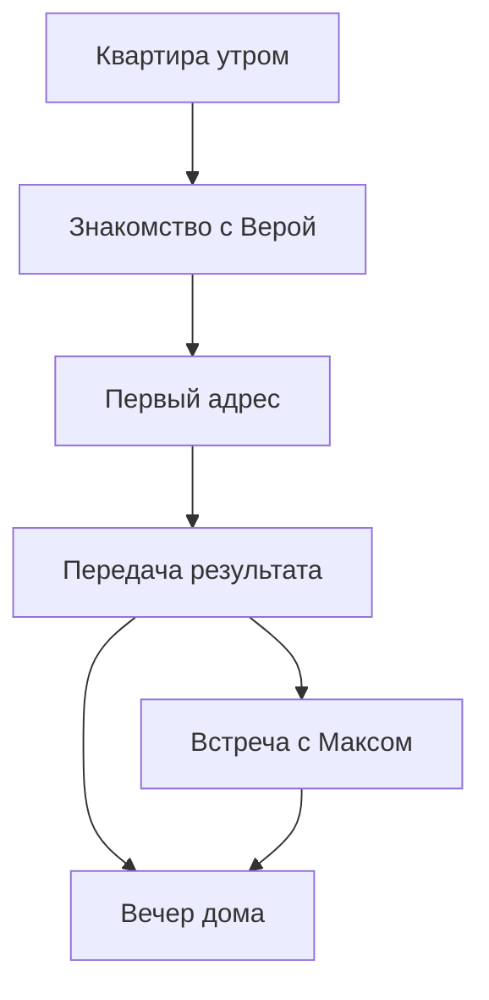

# Карты жизни Ани

Главная единица игры — день одной героини. Ане 25 лет, она выходит на первую работу переписчицей. Карта раскрывает новые места её жизни и работы; повышение масштаба не превращает её автоматически в управляющую чужими персонажами.

## Первый игровой день

В текущем эпизоде используются две пространственные сцены. Одни и те же места получают разный смысл утром и вечером.

| Сцена | Утро / смена | Вечер | Что видно в мире |
| --- | --- | --- | --- |
| Квартира | Собраться, выбрать образ, позавтракать по желанию, взять рабочую сумку | Вернуться, увидеть покупку, закончить день | Героиня ходит между предметами; выбранные вещи и домашние покупки меняют сцену |
| Лесная улица | Найти Веру, дойти до первого адреса, передать собранный результат | Встретить Макса, если Аня согласилась на приглашение, либо отправиться домой | Дороги, подъезд, скамейка, прохожие; перемещение предшествует встрече |

Телефон открывается поверх текущей локации. Чаты с командой, подругой и Максом не являются отдельными картами. Из телефона можно договориться о встрече или купить вещь; результат выбора проявляется в пространстве и последующих событиях.

Первый адрес — одна содержательная встреча. Семейные отношения и организация домохозяйства раскрываются в ответах людей, а не через цвет или внешний вид дома.

## Пространственная схема

Маршруты построены из разрешённых отрезков, соединяющих точки для ног персонажа. Нажатие на предмет задаёт путь к нему. Нажатие на пол выбирает ближайшую точку прохода. Повторное нажатие меняет маршрут через один из концов текущего отрезка; персонаж не прыгает на новую дорожку.

## Карта квартиры

Координатная система — 1000 × 700. Точки обозначают место, где стоят ноги, а не центр мебели. После замены иллюстрации правятся координаты и проходы в `src/life/movement.js`, а правила дня остаются в предметном ядре.

| Узел | Координаты | Назначение |
| --- | --- | --- |
| `bed` | 425, 300 | Начало утра и завершение дня у кровати |
| `wardrobe` | 220, 610 | Выбор образа |
| `kitchen` | 745, 325 | Завтрак |
| `table` | 610, 520 | Рабочая сумка и планшет |
| `door` | 920, 450 | Выход и возвращение |
| `sofa` | 390, 540 | Точка прохода у дивана; отдельное действие отдыха пока не реализовано |
| `center` | 490, 450 | Центральный проход |

Координаты привязаны к готовой иллюстрации `assets/apartment.webp`. Основной проход лежит справа от кровати и дивана, слева от обеденного стола. К двери героиня подходит по верхней стороне стола; путь к гардеробу проходит ниже кофейного столика. Дополнительные соединительные точки проводят путь между мебелью. Они не требуют подписей в интерфейсе. При повторном входе сцена может стартовать в `door`; обычное новое утро стартует в `bed`.

## Карта двора

Двор сохраняет рисунок `assets/courtyard.webp`. Проход к дальнему подъезду огибает центральный газон; скамейка доступна со стороны дорожки.

| Узел | Координаты | Назначение |
| --- | --- | --- |
| `base` / `exit` | 510, 560 | Вход во двор и путь домой |
| `mentor` | 580, 405 | Встреча с Верой у скамейки |
| `respondent` | 605, 275 | Первый адрес в дальнем подъезде |
| `date` | 580, 405 | Вечерняя встреча у той же скамейки |

`mentor` и `date` — разные смысловые цели в одной точке пространства. Сценарий определяет, кто ждёт Аню и какое действие доступно. Система движения не подменяет этот контроль.

Два фоновых жителя гуляют независимо. Их прибытия не запускают рабочие или романтические диалоги игрока. Пауза останавливает все перемещения.

## Как расширять мир

Следующие масштабы — план развития, а не обещание готовых уровней.

| Масштаб | Новые места | Новые решения героини | Работа и статистика |
| --- | --- | --- | --- |
| Дом и двор | Квартира, подъезд, скамейка | Режим дня, образ, первая покупка, первая договорённость | Первый контакт, состав домохозяйства, сохранение и передача анкеты |
| Квартал | Магазин, кафе, остановка, несколько дворов | Время в пути, регулярные встречи, домашние планы | Несколько адресов, время доступности людей, повторное посещение |
| Район | Разные счётные участки, общественные пространства | Выбор маршрута и вечера, отношения с командой, новые увлечения | Полнота охвата при переписи; отдельные назначенные адреса при выборочном обследовании |
| Город | Транспортные связи и новые районы | Долгосрочные цели, смена жилья, устойчивые отношения | Разные программы обследований и накопление профессионального опыта |

Доступ к новым местам связан с событиями и возможностями Ани. Романтическая линия не обязана быть условием профессионального роста. Домашние улучшения остаются в квартире и дают ощущение личной истории. Роль наставницы или координатора может появиться позже как отдельный выбор, а не как обязательная замена игры за героиню.

## Граница ответственности модулей

- `movement.js`: координаты, маршруты, направление и фаза ходьбы, событие прибытия.
- Предметное ядро: готовность к выходу, время дня, деньги, покупки, отношения, достоверность анкеты.
- Интерфейс: доступные предметы и встречи, картинка, камера, показ диалогов.

Движение не хранится как источник истины о выполнении задачи. Только завершённое действие в предметном ядре меняет прогресс дня. Это позволяет менять квартиру и карту района без переписывания событий.

## Карты повторяемых обследований и совместного участка

Это план следующего этапа. Географическая карта отделяется от слоя заданий: у программы и волны свой набор объектов, а у каждого назначения — исполнитель и состояние. Одна улица может появляться в разных обследованиях; состав выборки не заменяется удобными соседними адресами. В переписи карта показывает полноту охвата установленной территории и объектов.

Игрок ходит по району своим персонажем. В будущем на рабочем слое видны свободные и назначенные адреса, договорённые визиты, материалы к передаче и принятые результаты. Для команды добавляются исполнители и общий ход сбора. Передача адреса сохраняет договорённости и черновик; подтверждает её сервер. Личная карта дома, покупок и встреч остаётся отдельной частью жизни героини.

Текущая игра использует один адрес и две сцены. Сетевая карта и повторяемые задания ещё не реализованы.
