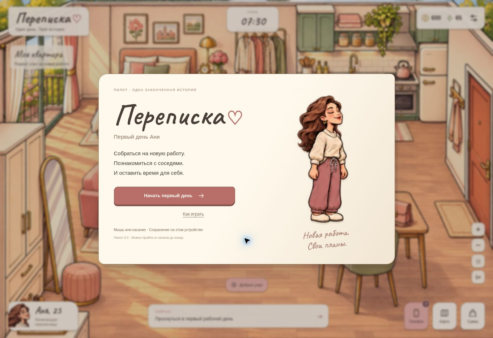

# Пилот 0.3 — первый день Ани

Версия приложения: `0.3.0`. Дата подготовки: 17 ноября 2026 года.

[Ссылка для передачи коллегам](https://perepiska-living-lines.carlafloriano1958.chatgpt.site)

## Состав версии

- Приветствие с началом или продолжением истории, один законченный день и итоговый экран.
- Квартира и двор: сборы, одежда, завтрак, рабочая сумка, покупки и возвращение домой.
- Первая анкета: два постоянных жителя с отдельными хозяйствами и один гость. Принятие анкеты приносит 300 игровых монет один раз.
- Восемь собеседников: короткие законченные знакомства и продолжения, доступные после событий этого же дня. Личные ответы не влияют на статистические данные и оплату.
- Необязательная встреча с Максом и полноценное завершение с вечером дома.
- Новые атласы полнофигурных персонажей: восемь кадров ходьбы, четыре кадра покоя, переходы скорости, разворот и привязка к ногам. У Киры и троих собеседников по адресу — портреты с морганием.
- Локальные сохранения v2, совместимость с прежними сохранениями личного первого дня, экспорт и импорт JSON.
- Управление мышью, пауза пробелом, закрытие обычных панелей по Esc, настройка уменьшения движения.

В эту версию не входят мультиплеер, облачная синхронизация, каталог повторяемых обследований, новые игровые дни, реальные платежи и магазинные сборки. Будущий основной заработок — принятые анкеты разных обследований; сейчас реализована одна учебная анкета. Планы на следующую встречу сохраняются как выбор истории, а не как уже доступный уровень.

Снимки версии: [двор](preview-pilot03.jpg) · [итог первого дня](preview-ending03.jpg).

## Проверка перед передачей

17 ноября выполнено полное браузерное прохождение на компьютере в области **1363 × 936**. Подробности и исторический отчёт — в [QA.md](QA.md). Финальная сборка `cf45f406007c` опубликована; проверены публичный стартовый экран «Пилот 0.3» и встроенная инструкция.

| Проверка | Статус | Результат / окружение |
| --- | --- | --- |
| Автоматический набор `npm test` | Пройдено | 87 из 87; движение — 19, анимация — 10, разговоры — 12 |
| Стресс-проверки движения | Пройдено автоматически | 96 сценариев без зарегистрированных пересечений / блокировок; 26 подходов к персонажам |
| Финальная `npm run build`; запуск результата после последних правок | Пройдено | `cf45f406007c`, 37 файлов; стартовый экран и инструкция опубликованной версии работают |
| Публичный доступ к опубликованной версии | Подтверждён | Sites: `public`, revision 2; браузер открыл игру без экрана входа. На компьютере коллеги отдельно не проверялось |
| Новая история от приветствия до итога дня | Пройдено в браузере | Утро, первый адрес, принятая анкета, вечер, итог в 21:00 |
| Продолжение после перезагрузки | Пройдено в браузере | Сохранены 600 монет, растение и исход романтической ветки |
| Мышь, пауза пробелом, масштаб, справка и Esc | Пройдено в браузере | Компьютер, 1363 × 936 |
| Восемь собеседников и продолжения Веры, Дениса, Киры и Макса | Пройдено в браузере | Включая возвращение к опросу и повторное открытие Веры после перезагрузки |
| Ошибочный состав анкеты и однократная оплата | Пройдено в браузере и тестах | Одно хозяйство отклонено; два хозяйства без гостя приняты; баланс 600 → 900 один раз |
| Покупка растения и его появление дома | Пройдено в браузере | Баланс 900 → 600; повторная покупка недоступна |
| Вечер без романтики, старое v2, конфликт вкладок | Пройдено автоматически | Отдельный браузерный проход этих вариантов в текущем цикле не выполнялся |
| Уменьшение движения, ходьба, покой и портреты | Проверено при настольном прохождении | Настройка переключается; FPS и нагрузка не измерены |
| Журнал браузера | Ошибок приложения не обнаружено | Сообщения расширений исключены |
| Экспорт / импорт через выбор файла | Не проверено в браузере | Автоматическая проверка сохранений не заменяет путь выбора файла |

В ходе проверки исправлены приоритет перекрывающихся областей нажатия, поздний разговор после отменённого подхода к NPC и повторное открытие вечерней Веры. У нового этапа разговора убрано повторение старой утренней реплики; подписи учитывают высоту персонажей. После последних интерфейсных правок сборка прошла, опубликованный стартовый экран проверен.

Физические телефоны, офлайн-поведение, устойчивый FPS, память, длительная нагрузка и полный проход с экранным диктором не проверены. Настольное прохождение не заменяет эти испытания.

## Опубликованный результат

Источник игровой сборки: `aa292c1c82219471bb4120b25388eb27bea7c75c`. Публикация Sites: `appgdep_6afc36e938b08191833b53d8cfdc7a5a`, статус `succeeded`.

