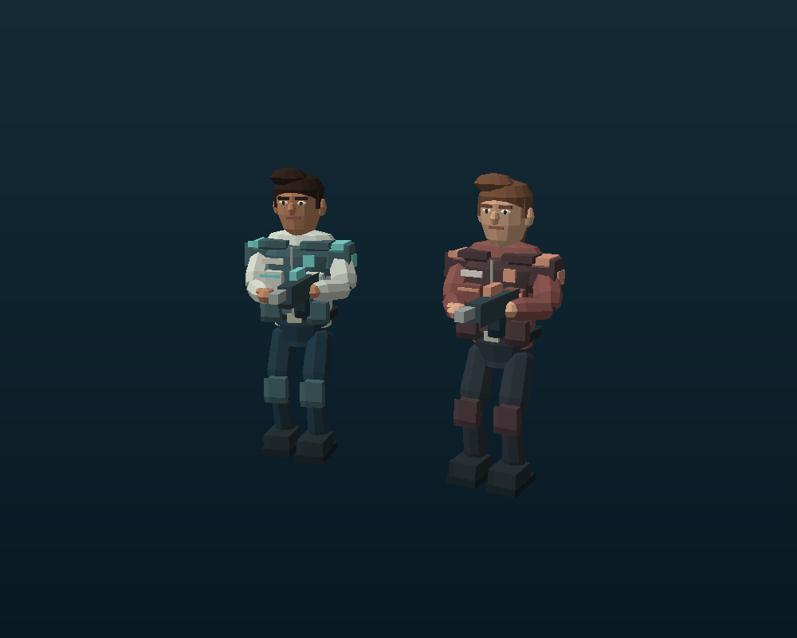
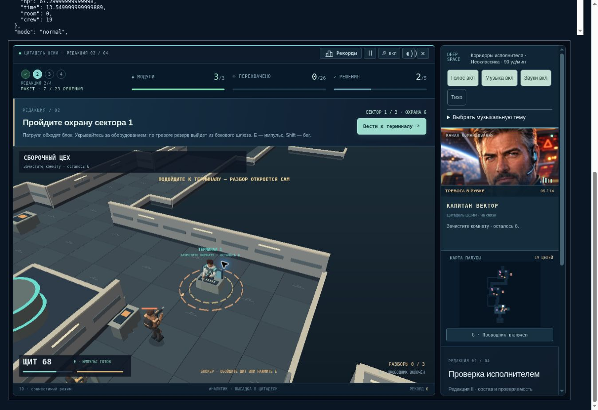

# Цитадель ЦСИИ 2.0.0 — отчёт QA

Дата: 19 октября 2026. Проверяемая версия: 2.0.0, графика 200r3, защитный цикл 193r2.

## Результат

После выпуска исправления 1.9.3 выполнена отдельная переработка пяти баз: уровней **2, 5, 8, 11 и 13**. Публичная точка входа — https://andrejk-blip.github.io/cmpon-atlas/ . Сведения о финальном развёртывании и сверке файлов находятся в `publication.json`.

Предыдущий выпуск и расследование зависания зафиксированы коммитом `e25cd4e42eb175dd796d687fae3b26c9f39bf0d9`; полный отчёт — [QA 1.9.3](../qa-1.9.3/QA.md). Диагностика и исправление рекурсивных обёрток сохранены.

## Что изменилось

- Авторские планировки с кольцевыми маршрутами вокруг оборудования, боковыми помещениями, сервисными обходами и шлюзами между тремя секторами. Пять различных маршрутов базы, 428–544 клетки пола. Закрытые шлюзы проверены на отсутствие обхода до разбора карточки.
- Полный конечный состав охраны находится на базе с момента высадки. Патрули движутся между постами; часовые наблюдают сектор; выстрелы вызывают проверку шума. После обнаружения цели отряд получает тревогу, резерв выходит из физического помещения через дверь. Случайного появления рядом с игроком и телепортации застрявшего патруля в новых базах нет.
- Стрелки занимают точки у укрытий; тяжёлые бойцы прикрывают сближение; связист восстанавливает союзника; ракеты и рывки сохраняют предупреждение. Движение проходит через проверенный граф проходимости, с физическим разведением соседних бойцов и повторным поиском пути при препятствии.
- Здоровье охраны в обычном режиме умножается на `1.30 + 0.13 × номер базы + 0.055 × номер сектора` относительно базового архетипа; в спокойном режиме применяется коэффициент 0.82 и меньший состав поздних отрядов. Формулы начисления очков и тексты учебных карточек не изменены. Итоговые очки и время между версиями 1.9.3 и 2.0.0 прямо несопоставимы из-за нового состава и планировок.
- Новые низкополигональные человеческие модели: лицо, нос, глаза, брови, волосы, варианты бороды/собранных волос, воротник, погоны, карманы, подсумки, кисти, обувь и оружие. Двухсегментные ноги и руки; фаза шага зависит от пройденного расстояния, разворот корпуса плавный, движение учитывает направление бокового шага.
- Новые стены, шкафы, пульты, центральные установки, маркировка и свет. Увеличено поле базы на компьютере; командный канал доступен ниже. В Canvas добавлен буфер глубины вместо сортировки центров треугольников, устранены диагональные артефакты перекрытия.
- Нет нового независимого игрового цикла, таймеров, подписок или обёрток `emit`. Статическая геометрия и модели переиспользуются; объём кэшей ограничен набором планировок и внешностей.

## Реальный браузер

Среда: облачный Chrome, Canvas fallback. Аппаратный WebGL в этой среде недоступен. Полные прогоны применяли **120 обычных шагов на нативный RAF**. Это ускоренное прохождение и проверка интеграции; оно не является замером FPS или длительным ручным прохождением.

| Режим | Уровни | Разборы | Результат | Шаги оператора | Время наблюдения |
|---|---:|---:|---|---:|---:|
| Обычный | 14/14 | 23/23 | Победа | 57637 | 669 с |
| Спокойный | 14/14 | 23/23 | Победа | 55440 | 492 с |

В обоих: 0 ошибок приложения, 0 отказов цикла, 0 изменений цепочки `emit`, одно ожидающее основное RAF. Web Audio работал, загружались записи, источник голоса — recorded; субъективную слышимость/качество звука тест не оценивает.

В обычном режиме была реальная пауза после переключения фокуса при включении звука; игра продолжена кнопкой «ПРОДОЛЖИТЬ». До первого взаимодействия автоматизации число глобальных обработчиков было 57, после — 70 и затем оставалось постоянным. Источник однократного прироста не установлен; линейного роста нет. В спокойном прогоне — постоянные 57. В консоли также встречались сообщения расширения браузерной автоматизации, отдельно от нулевого журнала ошибок игры.

Зафиксированные максимумы JS heap в периодических браузерных выборках: 333.2 MiB / 287.8 MiB. Это значения между сборками мусора, не размер утечки и не полная память процесса/GPU.

**Ручные действия без ускорения:** загрузка достигнутой контрольной точки уровня 5, команда проводника, движение от `[0,0,30]` к терминалу, открытие шлюза, получение реального урона, разворачивание поля, пауза и продолжение. На паузе от 315 до 373 секунд наблюдения положение, щит 71.66 и время базы 13.07 с не изменялись. После продолжения время выросло до 13.63 с, возобновились атаки. Полного ручного прохождения не было. Облачный RAF выдавал приблизительно один кадр в секунду, поэтому 531 с наблюдения не равны 531 с игрового времени.

Полные браузерные прогоны относятся к игровому коду из `ac865dc8c0b4c49dbf2bda861712a2d7fb1ecfb4`. Последующие изменения 200r2/200r3 касаются ширины поля, подписи управления и положения изображения консоли перед площадкой взаимодействия. Игровая логика и геометрия коллизий не менялись; окончательная цепочка отдельно проверена регрессией и публичным smoke-тестом.

## Программная имитация

| Проверка | Результат | Условия |
|---|---|---|
| Полная кампания, обычный | 14/14, 23/23, победа | 57251 шагов; 953.52 с симуляции |
| Полная кампания, спокойный | 14/14, 23/23, победа | 53120 шагов; 884.67 с симуляции |
| Новые базы | 8/8 групп | Связность, шлюзы, патрули, резерв, переход карточки, сохранения, пауза, отрисовка, повторное подключение |
| Мобильное отображение ввода | 10/10 баз | Все пять баз × два режима через joystick/fire/pulse mapping; это не физический телефон |
| Защита цикла 193r2 | 10/10 | Контролируемые исключения, потеря RAF, ошибки хранилища, потеря контекста, ограничение журнала |
| Интеграция точной цепочки | Результат в `integration.json` | Инициализация, учебные карточки, погоня, рой, голос, совместимость API Android |
| Старые сохранения | 5/5 баз 1.9.3 | Сохранены геометрия, координаты, здоровье, состав и прежние правила; новые карты — со следующей высадки |

Автооператор знает координаты и правильные ответы. Он подаёт обычные команды движения/стрельбы/импульса/ответа. Здоровье, боезапас, урон, состав врагов и статус победы не подменяются. Начальные точки для отдельных баз получены полным прохождением, а не конструированием победы. Отдельные unit- и художественные fixtures явно обозначены и не считаются прохождением.

Длительность баз в полных кампаниях (точный оператор, не оценка сложности для человека):

| Уровень | Обычный, с | Мин. щит | Спокойный, с | Мин. щит |
|---|---:|---:|---:|---:|
| 2 | 64.98 | 94.00 | 64.34 | 96.40 |
| 5 | 74.17 | 89.10 | 67.26 | 96.73 |
| 8 | 75.14 | 94.10 | 68.55 | 95.75 |
| 11 | 71.45 | 94.92 | 66.23 | 100.00 |
| 13 | 79.08 | 94.56 | 75.42 | 100.00 |

## Длительные и нагрузочные проверки

1. Два параллельных прогона Node VM с реальной задержкой 16 мс перед каждым шагом: обычный **1009 с (16.82 мин)**, спокойный **931 с (15.52 мин)**. Каждый завершил все 14 уровней и 23 разбора. 65 глобальных обработчиков постоянно, 0 замен `emit`, 0 ошибок. Heap после GC: примерно 43.8 → 55.3 MiB с прогревом. Это две отдельные сессии, не непрерывный 32-минутный браузерный тест.
2. Полная кампания с **731 реальными отрисовками native Canvas 1024×640**: 136 с стендового времени, все 14 уровней/23 разбора. Проверялись конечные матрицы и неизменность состояния при отрисовке. Медиана 83.6 мс, p95 155.1 мс в Node VM; это не браузерный FPS. К завершению прогрето 41 сочетание модели/внешности и 5 планировок.
3. **50 загрузок баз и 200 отрисовок в одном окружении**, 49 с: после прогрева число мешей 3628 постоянно; heap после GC 74.65 → 74.70 MiB, обработчиков 65. Количество объектов кэша вышло на плато.
4. Повторная загрузка трёх новых модулей 25 раз: функции и число обработчиков не меняются. Подробности — `bases-regression.json`.

Длительные и native-render прогоны начали работу до косметической правки 200r3. Их JSON содержит SHA фактически исполненных файлов. Финальная 200r3 прошла повторный `bases2-regression` и проверку публичных файлов; игровой код в этих сборках одинаков.

## Изменённые файлы

- `assets/citadel-bases-v2.0.0.js` — планировки, постоянный состав, AI, плавность движения.
- `assets/citadel-decks-v2.0.0.js` — подключение нового поведения, старые правила для сохранённых баз, контроль зачистки.
- `assets/citadel-bases-view-v2.0.0.js` — модели, анимация, окружение, камера, Canvas с глубиной, компоновка и подпись управления.
- `assets/citadel-bases-v2.0.0.css` — широкое поле базы на компьютере.
- `index.html`, `atlas.html`, `version.json`, `RELEASE-2.0.0.md` — новая цепочка, версия, контрольные суммы.
- Тесты `bases2-*`, изолированный `entry-2.0.0.html`, дополнительные параметры отчёта в существующих тестах, JSON-доказательства и изображения в этом каталоге.

Ядро `atlas-v1.3.5.js`, образовательный банк, форматы `citadel-review-v3` / `citadel-finale-v1`, музыка, голос и исправленные SFX/comic-модули 1.9.3 не изменены. `source-manifest.json` содержит контрольные суммы конечной поставки.

## Ограничения и оставшиеся риски

- Нет проверки на конкретном компьютере пользователя, аппаратном WebGL, физическом телефоне и нескольких браузерных движках. Низкие графические ресурсы могут давать просадки; ускоренный прогон не доказывает 60 FPS.
- Стиль — детализированная низкополигональная 3D-графика; это не фотореалистичные модели. Оружие и конечности анимированы, полноценного motion capture/физики тел нет.
- Сложность для человека требует игровой обратной связи. Автооператор точно целится и знает карту; его высокий остаток щита не доказывает лёгкость для человека.
- Существующая база из старого сохранения сохраняет старую карту и правила до новой высадки. Новая графика применяется и к сохранённым помещениям.
- Закрытая админка и реальная отправка результатов турнира не тестировались: доступ требовал авторизации. Тестовые данные изолированы от настоящих аккаунтов/сохранений.
- Диагностика остаётся локальной: ограниченные события и обезличенные состояния. Резервная копия прогресса хранится отдельно локально; её содержимое не отправляется в аналитику.

## Воспроизведение

```sh
node tests/bases2-regression.cjs
node tests/bases2-campaign.cjs
node tests/bases2-campaign.cjs --calm
node --expose-gc tests/bases2-campaign.cjs --paced
node --expose-gc tests/bases2-campaign.cjs --calm --paced
node tests/bases2-touch.cjs
node --expose-gc tests/bases2-render-stress.cjs
node --expose-gc tests/bases2-cache-stress.cjs
node tests/runtime193-regression.cjs --report tests/qa-2.0.0/runtime.json
node tests/mission-integration-regression-1.9.1.cjs --report tests/qa-2.0.0/integration.json
```

Для браузерного теста: `tests/bases2-browser.html`. Выбор «Вся кампания» запускает с начала; выбор базы загружает синтетическую достигнутую контрольную точку. По умолчанию ускорение выключено. Стенд не читает пользовательское хранилище и блокирует внешние сетевые вызовы.




