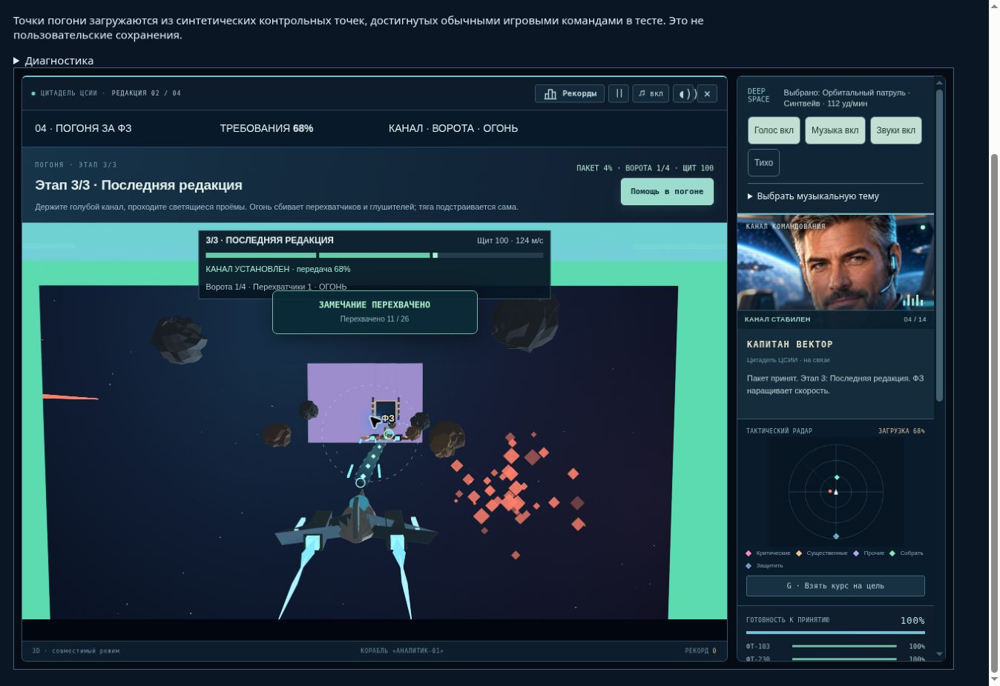
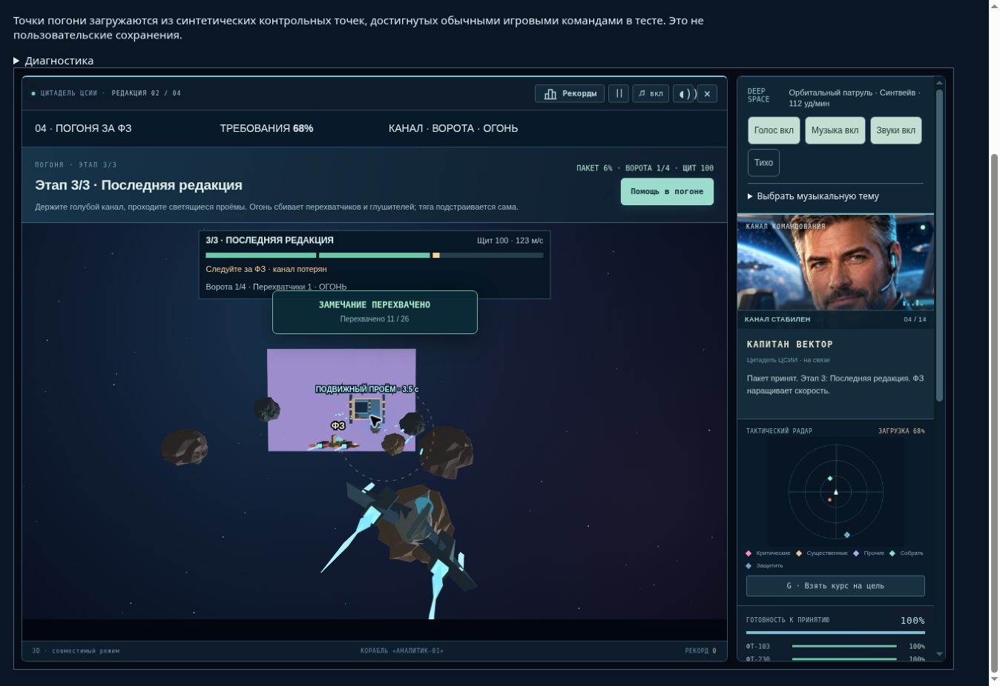

# Цитадель ЦСИИ 2.1.0 — QA погони за ФЗ

Дата: 19 октября 2026. Модуль погони 2.1.0, стили 210r2, защитный цикл 193r2.

Игра: https://andrejk-blip.github.io/cmpon-atlas/ . Проверка развёртывания и контрольных сумм — `publication.json`; состав поставки — `source-manifest.json`.

## Механика

Канал соединяет две реальные точки кораблей. Это полупрозрачная лента с движущимися пакетами и обозначенными концами; постоянного следа за ФЗ больше нет. После 0.55 с удержания сигнала начинается передача. При разрыве канал исчезает и передача останавливается; накопленный прогресс не уменьшается.

| Стадия | Передача, обычный / спокойный | Базовая скорость ФЗ | Рывок | Минимум пройденных ворот |
|---|---:|---:|---:|---:|
| Захват сигнала | 38 / 30 с | 82 м/с | +17 м/с | 2 |
| Канал под огнём | 46 / 38 с | 103 м/с | +26 м/с | 3 |
| Последняя редакция | 58 / 46 с | 124 м/с | +35 м/с | 4 |

В спокойном режиме скорость ФЗ составляет 90% указанной; допустимое боковое отклонение увеличено на 4 м. Каждый пакет даёт треть общего прогресса, независимо от времени его передачи. Итог: 142 / 114 с именно соединённого канала, без учёта манёвров, помех и стыковки. Пропущенные ворота можно компенсировать следующими, без перезапуска.

Маршрут детерминирован расстоянием и seed. ФЗ следует через физические проёмы; перемещения, ускорения и боковые манёвры усиливаются между стадиями. Игрок проходит кольца, перегородки и движущиеся створки. Геометрия стен общая для изображения, столкновения, снарядов и проверки канала. Столкновение с перегородкой наносит 20 урона, с астероидом — 17; после него требуется восстановить связь.

Перехватчики появляются впереди на флангах, входят в строй, предупреждают об атаке и уходят после захода. Глушитель блокирует передачу в зоне действия. Для него работают обычные попадания, ракеты и импульс; скрытой квоты убийств нет. В сцене не более четырёх противников. Прицел погони учитывает её высокую скорость; прежний расчёт перехвата на скорости обычного полёта для этого недостаточен.

## Реальный браузер

Облачный Chrome, Canvas fallback, настоящие скрипты страницы и Web Audio. Полные прохождения погони выполнял автооператор через обычные команды: **120 шагов на нативный RAF**. Это проверка браузерной интеграции, не ручное прохождение и не измерение FPS. Начальное сохранение достигнуто полным программным прохождением уровней 1–3.

| Режим | Время погони в игре | Пакеты / карточки | Сбито / глушителей | Пройдено ворот | Результат |
|---|---:|---:|---:|---:|---|
| Обычный | 159.89 с | 3 / 2 | 17 / 7 | 33 | Стыковка, достигнут уровень 5 |
| Спокойный | 118.30 с | 3 / 2 | 12 / 5 | 21 | Стыковка, достигнут уровень 5 |

В обоих прогонах: ноль ошибок приложения, отказов и восстановлений runtime, одно ожидающее основное RAF. Обработчики стабильны после запуска: 70 в обычном и 57 в спокойном. Единственная смена `emit` произошла при начальном подключении сохранённого движка; дальнейшего роста нет. В браузерных выборках heap колебался с GC: 33.8–174.9 MiB / 34.8–165.2 MiB. Это не замер полной памяти процесса или GPU. Записи `browser-normal.json`, `browser-calm.json` включают также последующее ожидание на паузе; его нельзя считать временем прохождения.

Web Audio находился в состоянии running, загружено 16 клипов, использовались звуки выстрела, попадания, уничтожения и записанный голос. Субъективное качество/громкость звука тестом не оценивались.

Отдельная сессия без ускорения: загрузка достигнутой точки третьей стадии, разворачивание экрана, пауза от потери фокуса, продолжение, уход вправо и возвращение к ФЗ. В режиме `off-course` канал отсутствовал; между игровыми 115.9167 и 117.5567 с прогресс оставался ровно 68.74521072796935%. После возвращения канал восстановился: к 121.9167 с загрузка выросла до 70.46935%. Реальные браузерные снимки — `browser-connected.jpg`, `browser-disconnected.jpg`; подробные состояния — `browser-channel-check.json`.

При этой проверке найден и исправлен дефект CSS: широкий одноколоночный макет наследовался развёрнутым экраном и сжимал его первую строку до 3 пикселей. Теперь широкий вариант применяется только вне `.is-expanded`. После исправления: колонки 963 / 285 px, игровая секция высотой 800 px, Canvas 961 × 540.56 px внутри видимой области. Аналогичный селектор исправлен у баз; механика баз не менялась.

## Программная имитация

Исполняется точная цепочка скриптов `index.html` в Node VM. Автооператор знает координаты и ответы и подаёт обычные команды. Здоровье, боезапас, урон, враги и статус победы для прохождения не изменяются. Изолированные fixtures для проверки столкновений отдельно обозначены и не считаются прохождением.

| Проверка | Результат |
|---|---|
| Погоня: 3 seed × 2 режима | 6/6; обычный 159.85–172.37 с, спокойный 118.27 с |
| Полная кампания, обычный | 14/14 уровней, 23/23 карточки; победа; 61 542 шага, 1025.03 с симуляции |
| Полная кампания, спокойный | 14/14 уровней, 23/23 карточки; победа; 56 363 шага, 938.72 с симуляции |
| Контракты новой погони | 9/9 групп |
| Интеграция: ввод, карточки, погоня, рой, звук/голос | 9/9 |
| Защита игрового цикла 193r2 | 10/10 сценариев |
| Клавиатурные команды 60 Hz / touch mapping 30 Hz | Оба прохождения завершены, по 18 сбитых противников |
| Прохождение без огня | Поражение через 436.07 с, щит 0, загрузка 80.52%: атаки и помехи действительно действуют |
| Старое частичное сохранение 1.9.0 | 48.0039% преобразованы без сброса щита/очков/решений; миссия завершена, три требования без дубликатов |
| Новое сохранение на стадии 3 | Враги, снаряды, створки, прогресс восстановлены; следующие 5 с побитово совпадают с непрерывной симуляцией после JSON-нормализации |
| Пауза / продолжение | Состояние на паузе не меняется, затем обновление продолжается |
| Native Canvas: 1280×720, 390×460 DPR2, 844×320 | Состояние не меняется при рисовании, HUD в границах; это не физический телефон |
| Повторное подключение модуля 40 раз | Те же функции и 65 обработчиков, без новых обёрток |

Файлы: `mission.json`, `campaign-normal.json`, `campaign-calm.json`, `contracts.json`, `input-modes.json`, `no-fire.json`, `integration.json`, `runtime.json`.

## Нагрузка и стабильность

Один полный прогон новой погони с реальной задержкой 16 мс на шаг: **177.905 с стендового времени**, 10 154 шага, завершены передача, два разбора и стыковка. Постоянные 65 обработчиков, ноль смен `emit`; heap после GC вырос при прогреве с 43.71 до 44.89 MiB. Пики: 4 противника, 21 астероид, 3 ворот, 26 снарядов игрока, 1 вражеский снаряд. При точной стрельбе оператор быстро сбивает врагов; больший поток вражеского огня проверен отдельным прогоном без огня. Все игровые массивы ограничены и удаляют ушедшие объекты. Доказательство — `paced-normal.json`.

Это короткий непрерывный стендовый прогон новой миссии, не многочасовая проверка компьютера пользователя. Более длительные проверки предыдущей версии описаны в [QA 2.0.0](../qa-2.0.0/QA.md); они не выдаются за проверку нового модуля. Защита от прежней рекурсии SFX/comic остаётся неизменной.

## Файлы и совместимость

- `assets/citadel-pursuit-v2.1.0.js` — три стадии, канал, препятствия, противники, попадания, HUD, миграция.
- `assets/citadel-pursuit-v2.1.0.css` — широкое игровое поле.
- `assets/citadel-bases-v2.0.0.css` — исправление селектора развёрнутого экрана.
- `index.html`, `atlas.html`, `version.json`, `RELEASE-2.1.0.md` — подключение и версия.
- `tests/pursuit210-*`, `tests/entry-2.1.0.html`, `tests/helpers/campaign-inputs.js`, `tests/mission-integration-regression-1.9.1.cjs` и этот каталог — стенды и доказательства.

Ядро, образовательный банк, музыка/голос, SFX/comic/runtime и основные схемы сохранений не изменены. В старой погоне сохраняются полученные требования и процент частичного пакета, но трасса начинается с безопасной геометрии соответствующей стадии. В новой погоне весь пространственный бой сериализуется. Диагностика остаётся локальной; пользовательские сохранения и персональные данные не передаются. Браузерный QA использует только синтетические сохранения в памяти и блокирует отправку результатов.

## Публикация

Код включён коммитом [fa839f40cf22e33fb436717b1c8d4364bd9beab7](https://github.com/andrejk-blip/cmpon-atlas/commit/fa839f40cf22e33fb436717b1c8d4364bd9beab7). GitHub Pages run `39228935392` завершён успешно. На основной странице в реальном Chrome подтверждены версия 2.1.0, модуль погони 2.1.0 и стили 210r2. Все 40 файлов манифеста получены по обычным публичным URL с HTTP 200 и точным совпадением SHA-256. Последующий коммит отчёта не меняет игру.

## Ограничения

- Аппаратный WebGL, компьютер пользователя и физический телефон в этом выпуске не проверялись. Облачный Chrome выдаёт около одного нативного RAF в секунду; это ограничивает оценку плавности. Ускорение проверяет игровую логику, не 60 FPS.
- Баланс для человека требует обратной связи: точный автооператор не моделирует ошибки игрока. Для прохождения нужны манёвры в трёх измерениях, удержание канала и стрельба; спокойный режим смягчает допуски.
- Существующие итоговые очки разных версий непосредственно несопоставимы: дополнительные противники дают обычные игровые очки.
- Закрытая админка, реальная регистрация и отправка рекордов не затрагивались.

## Повторение

```sh
node tests/pursuit210-regression.cjs
node tests/pursuit210-contracts.cjs
node tests/pursuit210-campaign.cjs
node tests/pursuit210-campaign.cjs --calm
node --expose-gc tests/pursuit210-regression.cjs --paced --smoke
node tests/pursuit210-regression.cjs --smoke --render
node tests/runtime193-regression.cjs --report tests/qa-2.1.0/runtime.json
node tests/mission-integration-regression-1.9.1.cjs --report tests/qa-2.1.0/integration.json
```

Браузер: `tests/pursuit210-browser.html`. Для полного прогона выбрать начало погони и режим. Сохранённые визуальные точки стадий доступны для обычного режима. Без ускорения можно проверить канал кнопками ухода с курса и следования; при потере фокуса продолжить игру её штатной кнопкой.




