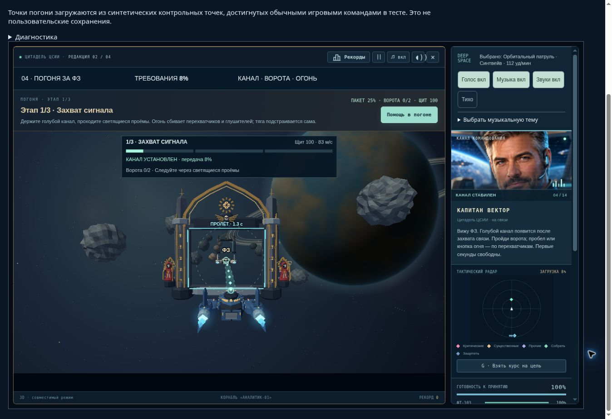
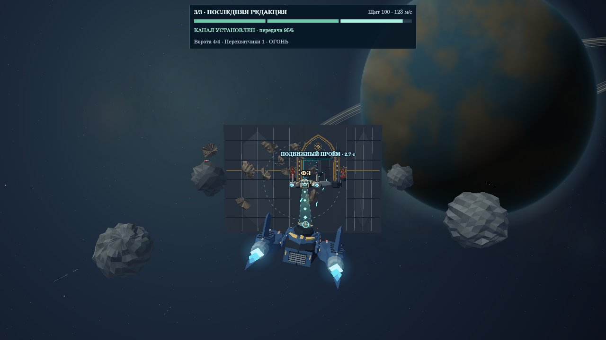

# QA — Цитадель ЦСИИ 2.2.0

Дата: 19 октября 2026. Область: графический движок и визуал погони за ФЗ, уровень 4.

## Результат

Проверки пройдены. Добавлены объёмные бронекорабли, соборные ворота, фигуры техножрецов, детальные астероиды и шесть вращающихся фрагментов при разрушении. Графика построена из настоящей геометрии сцены; изображения ниже — игровые кадры, не концепт-арт.



## Что проверено в реальном браузере

Chrome, публичный GitHub Pages, изолированный стенд `tests/pursuit220-browser.html`. Стенд загружает те же исходники через `tests/entry-2.2.0.html`, использует сохранения, достигнутые программным прохождением, и хранит данные только в памяти. Регистрация и отправка результатов отключены.

| Проверка | Результат | Доказательство |
| --- | --- | --- |
| Полная погоня, обычный режим | 3 стадии, 100% данных, переход на палубу; 159,89 игровых секунд | `browser-normal.json` |
| Полная погоня, спокойный режим | 3 стадии, 100% данных, переход на палубу; 118,30 игровых секунд | `browser-calm.json` |
| Цикл, исключения, обработчики | Ошибок страницы и отказов runtime: 0; один ожидающий RAF; 57 обработчиков в обоих прогонах | Те же отчёты |
| Звук и голос | AudioContext running; подготовленные эффекты загружаются и запускаются, источник голоса recorded | Те же отчёты; качество звучания на слух не оценивалось |
| Пауза настоящей кнопкой | Время замерло на 10,98 с; после кнопки «ПРОДОЛЖИТЬ» время дошло до 13,34 с; затем штатная пауза по frame-gap облачного браузера | `browser-pause.json` |
| Развёрнутый игровой экран | Проверены готические ворота, фигуры, корабли, непрерывный канал между антеннами, интерфейс | `browser-gate.jpg`, `browser-combat.jpg` |

Это автоматизированные браузерные прогоны с обычными игровыми командами. Ускорение — 120 шагов симуляции на отображаемый кадр. Облачный браузер выдаёт примерно один RAF в секунду: результаты **не являются измерением FPS или ручным прохождением человеком**. WebGL в этом браузере недоступен; использован совместимый Canvas-рендер. В отдельных финальных кадрах новый CPU-проход занимал 22,4 и 23,6 мс при 519 901 пикселе; это отдельные замеры, не обещание устойчивых 60 FPS.

## Программные проверки

| Проверка | Результат | Отчёт |
| --- | --- | --- |
| Все 14 уровней, обычный режим | Победа, 23 учебных карточки, 1025,03 с симуляции | `campaign-normal.json` |
| Все 14 уровней, спокойный режим | Победа, 23 карточки, 938,72 с симуляции | `campaign-calm.json` |
| Погоня: 3 seed × 2 режима | 6/6; реальные попадания, уничтожение противников, ворота и загрузка данных | `mission.json` |
| Контракты погони | 9/9: канал, повреждения от стены, клавиатура, touch 30 Hz, отсутствие огня, сохранение, пауза, миграция 1.9.0, рендер и повторная загрузка модуля | `contracts.json` |
| Полная цепочка скриптов, старт, голос, обучение | 9/9 | `integration.json` |
| Владелец RAF, пропавший кадр, ошибки update/render, скрытая вкладка, восстановление контекста, сохранение и приватность диагностики | 10/10, включая намеренно внедрённые неисправности | `runtime.json` |
| Совпадение механики с 2.1.0 | 10 154 шага; сравнение игровых данных каждую секунду и в конце. Отличаются только добавленные визуальные фрагменты | `graphics.json` |
| Живые фрагменты: сохранение, пауза, истечение времени | Пройдены; 8 реальных расколов, пик 12 частей, предел 48 | `graphics.json` |
| Повторное подключение нового модуля | 40 повторов, функции не оборачиваются заново, 65 обработчиков в VM | `graphics.json` |
| Desktop / portrait / landscape | 1280×720, 390×460 при DPR 2, 844×320; отрисовка не изменяет сохранение | `contracts.json`, `layout-*.png` |

Полные кампании проверяют полёт, палубы, терминалы, карточки, рой, Параллакс и МРГ. Оператор знает позиции и правильные ответы. Он посылает команды управления и отвечает на карточки; здоровье, урон, враги, боезапас и условия победы не подменяются. Эти результаты доказывают достижимость победы, но не оценивают сложность для человека.

## Нагрузка и материалы

- Прогон с ожиданием между шагами: 179,505 с реального времени, 10 154 шага, без смены `emit` во время игры. Обработчиков постоянно 65. Heap после GC: от 45 991 544 до 47 315 760 байт. Рендер в этом прогоне не вызывался (`paced-normal.json`).
- Отдельно 91 настоящий Canvas-кадр 1280×720 для каждой версии, на одинаковых достигнутых состояниях трёх стадий. Медиана нового прохода со сборкой сцены — 78,64 мс; прежнего — 83,62 мс. P95 — 108,06 и 110,38 мс. Это Node VM и native Canvas, не браузерный FPS.
- Первый кадр 2.2.0 в том же тесте — 1063 мс: включает построение моделей, создание буферов и процедурного фона. Фон затем кэшируется. Это известная стоимость первого открытия/изменения размера, её нельзя скрывать за средним значением.
- В повторном рендере число шаблонов после прогрева оставалось 9, геометрий — 159. Heap после GC: 82,71–82,85 МБ для процесса с двумя экземплярами тестового движка. Это ограниченный стресс-тест, а не доказательство отсутствия любой утечки при многочасовой игре.
- Точный production GLSL с экспортированной игровой сценой отдельно скомпилирован и отрисован через native EGL/GLES Mesa llvmpipe: compile/link успешны, `glGetError=0` (`native-gles.json`, `native-gles.png`). Это программный GPU-драйвер, не браузер и не физическая видеокарта.



## Изменённые игровые файлы

- `assets/citadel-pursuit-view-v2.2.0.js` — модели, материалы, фрагменты, камера, CPU-буфер глубины, GL-проход и ограниченные кэши. Нет новых таймеров или слушателей событий.
- `assets/citadel-pursuit-view-v2.2.0.css` — оформление рамки и компактного блока задачи.
- `assets/citadel-pursuit-v2.1.0.js` — только выбор точек привязки канала к новой модели; прежние координаты остаются запасным вариантом.
- `index.html`, `atlas.html`, `version.json`, `RELEASE-2.2.0.md` — подключение, версия и описание.
- `tests/pursuit220-*`, `tests/entry-2.2.0.html`, этот каталог — воспроизводимые проверки и доказательства.

## Ограничения и оставшиеся риски

1. Нет замера на физическом компьютере пользователя, Safari/iOS и аппаратных WebGL-драйверах. Особенно важны слабые устройства и первый кадр после изменения размеров.
2. Оформление ворот сложнее коллизионной геометрии: безопасный проём и исходные препятствия сохранены. Статуи и декоративные элементы не вводят новых правил урона. Обломки — визуальные, без столкновений.
3. Визуальное качество нельзя честно выразить числом «в два раза». Для проверки приложены кадры до/после из одного состояния: `before-2.1.0.png` и `stage-1.png`.
4. Браузерные журналы содержали ошибки служебного расширения Chrome; игровые `error`/`unhandledrejection` пусты. Они не смешаны с отказами игры.

## Воспроизведение

```sh
node --expose-gc tests/pursuit220-regression.cjs
node tests/pursuit220-contracts.cjs
node tests/pursuit220-campaign.cjs
node tests/pursuit220-campaign.cjs --calm
node --expose-gc tests/pursuit220-graphics.cjs
node tests/pursuit220-art.cjs
node tests/pursuit220-export-gl.cjs
python tests/pursuit220-egl.py
node tests/mission-integration-regression-1.9.1.cjs --report tests/qa-2.2.0/integration.json
node tests/runtime193-regression.cjs --report tests/qa-2.2.0/runtime.json
```

Native Canvas требует `@napi-rs/canvas`; EGL-проверка — libEGL/Mesa и Pillow. Полные хеши протестированных скриптов находятся в `integration.json` и отчётах кампаний. Результат проверки публичных файлов после выкладки — `publication.json`.

## Публикация

Код включён коммитом [b1be1e7fd94901d05fd60b65a3d40e2c278b1e18](https://github.com/andrejk-blip/cmpon-atlas/commit/b1be1e7fd94901d05fd60b65a3d40e2c278b1e18). GitHub Pages run [39256106553](https://github.com/andrejk-blip/cmpon-atlas/actions/runs/39256106553) завершён успешно. HTTP-проверка 44 файлов дала полное совпадение SHA-256 с протестированной сборкой. Основная страница в Chrome показывает 2.2.0 и подключает новый графический модуль `220r1`.
